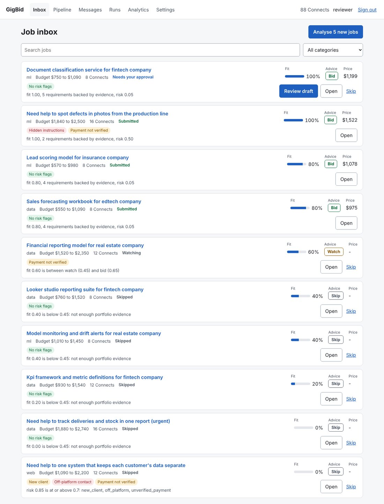
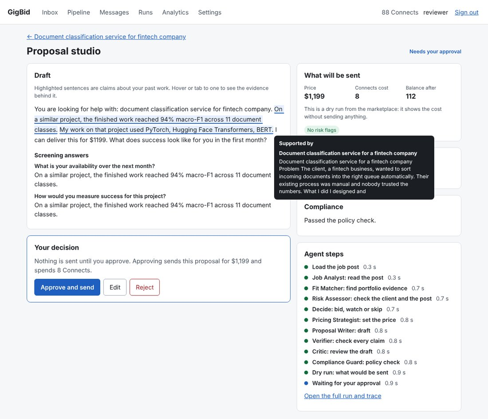

# GigBid

A multi-agent freelancer copilot: LangGraph agents find freelance jobs, judge whether
they are worth bidding on, write proposals grounded in real portfolio evidence, and
manage client conversations. A human approves every proposal and message before it
leaves the system.

AI-4016 R&D assignment, FAST-NUCES. Work in progress; results, live link and traces are added as they are measured.

## Run the app

Two terminals. The first is the API (FastAPI: GigSim, the MCP servers and both agent graphs in one process), the second is the web app.

```
uv run uvicorn apps.api.main:app --port 8000        # real model from .env
cd apps/web && npm install && npm run dev            # http://localhost:3000
```

To try it with no API key and nothing heavy on the laptop, start the API with the stand-in models instead
(PowerShell: `$env:GIGBID_LLM="fake"; $env:GIGBID_RAG_MODELS="fake"; uv run uvicorn apps.api.main:app --port 8000`).
Sign in as `reviewer` / `reviewer` (ML persona preloaded), or create an account.




State is kept on disk (SQLite files under `data/processed/app/`): graph checkpoints, long-term memory, GigSim's
world, the run list and sessions. Stop the API while a draft is waiting, start it again, and the draft is still
waiting; approving it submits once (`tests/integration/test_api.py::test_a_pending_approval_survives_an_api_restart`).

Or both in containers: `make dev` (= `docker compose -f infra/docker-compose.yml up --build`), then
http://localhost:3000. It starts on the stand-in models unless you set `GIGBID_LLM=real GIGBID_RAG_MODELS=real`.
**The compose file and the two Dockerfiles are written but not run:** neither machine I worked on had a Docker
daemon, so only `docker compose config` (the file parses) is checked.

What is not built: live Upwork (OAuth), portfolio upload, "regenerate one paragraph", the Redis worker, Postgres
(SQLite instead), tracing in Langfuse (the run viewer shows the MCP audit trail by trace id instead) and a public
deployment.

## Run the tests

```
uv sync
uv run pytest -q                               # 84 tests: units, MCP contracts, both graphs, the API
cd apps/web && npm run build && npx playwright test   # 5 UI tests in Chrome, laptop and phone sizes
```

CI (`.github/workflows/ci.yml`) runs both on every pull request, plus a 30-job smoke eval and the eval gates
(`evals/runners/gate.py`, thresholds under `eval_gates` in `agent/config.yaml`).

## Run the evaluations

```
uv run python -m evals.runners.run_all --only rag     # retrieval + ablation, no LLM
uv run python -m evals.runners.run_all                # everything (same as `make eval`)
uv run python -m evals.runners.run_all --smoke        # 30 jobs with stand-in models, no network
```

Results are written to `evals/results/*.json`; `evals/runners/results_table.py` turns them into the table below.
`evals/kaggle_eval.ipynb` runs the same thing on a free Kaggle GPU with a local model.

## RAG results

Regenerate with `make eval`.

<!-- results:start -->
| Variant | Evidence Recall@5 | nDCG@10 | Unsupported claims per proposal (before -> after verification) | Judge score (1-5) | GigSim reply rate | p95 latency (s) | Cost per proposal (USD) | Retrieval p95 (ms) |
|---|---|---|---|---|---|---|---|---|
| keyword | 0.572 | 0.705 | - | - | - | - | - | 3 |
| v0_naive | 0.806 | 0.890 | 0.03 -> 0.00 | 4.23 | 0.83 | 99.4 | 0.00000 | 153 |
| v1_decompose | 0.651 | 0.764 | - | - | - | - | - | 220 |
| v2_hybrid | 0.889 | 0.917 | - | - | - | - | - | 155 |
| v3_rerank | 0.771 | 0.877 | - | - | - | - | - | 1152 |
| v4_outcome | 0.702 | 0.822 | - | - | - | - | - | 154 |
| v8_corrective | 0.556 | 0.709 | - | - | - | - | - | 3224 |
| hybrid_corrective | 0.557 | 0.704 | - | - | - | - | - | 3126 |
| all_steps | 0.586 | 0.729 | - | - | - | - | - | 24200 |
| best | 0.889 | 0.917 | 0.00 -> 0.00 | 4.07 | 0.77 | 85.6 | 0.00000 | 157 |

Retrieval: 600 dev jobs, embeddings `nomic-ai/nomic-embed-text-v1.5`, reranker `Xenova/ms-marco-MiniLM-L-6-v2`, commit 2ba4e4d (`evals/results/rag_eval.json`). Proposals: 30 fixed dev jobs per variant, model `ollama: gpt-oss:20b / gpt-oss:20b`, on Linux x86_64, 4 CPU cores, x86_64 (`evals/results/gigsim_outcomes.json`). Cost is the provider's list price; free tiers and local models cost 0.
<!-- results:end -->

## Tool granularity (R&D question A)

40 tasks with a known correct tool and arguments, given to the model twice: with the 17 fine-grained MCP tools, and with
3 coarse tools (one per server, an `action` name and free `params`). Real model (`gpt-oss:20b` on Kaggle, 2 x T4, commit
c80d555). Numbers from `evals/results/tool_study.json`; the hypothesis is at the top of `evals/runners/tool_study.py`.

| | 17 fine tools | 3 coarse tools |
|---|---|---|
| Right tool chosen | 39 of 40 | 39 of 40 |
| Right tool and right arguments | 35 of 40 | 17 of 40 |
| Input tokens per task | 4,119 | 1,007 |
| Seconds per task | 4.6 | 2.1 |

## Proposal experiment (signature extension X2)

Dense-only against hybrid retrieval on the same 30 jobs: 25 against 23 replies, McNemar exact p = 0.73, not significant.
See `docs/EXTENSION.md` and `evals/results/ab_test.json`.
