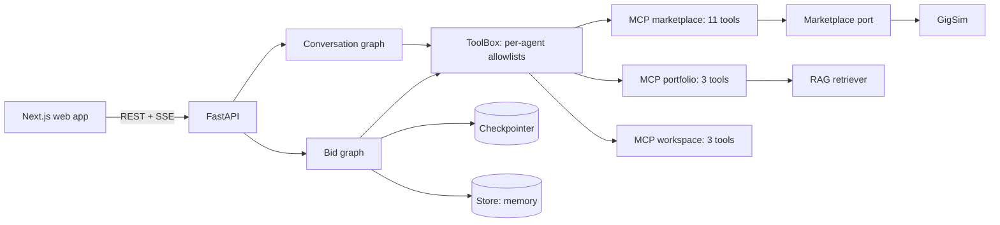

# Architecture

GigBid reads job posts, decides which are worth a bid, prices them, drafts a proposal from the freelancer's own
portfolio, and drafts replies to clients. **Agents read, analyse and draft. Only a human sends.**



## The pieces, and where they live

| Piece | Where | What it does |
|---|---|---|
| Bid graph | `agent/graphs/bid_graph.py` | One thread per job, from the post to a submitted proposal |
| Conversation graph | `agent/graphs/conversation_graph.py` | One thread per client message, from reading to a sent reply |
| Agents (nodes) | `agent/nodes/` | One file per agent; each has one job |
| Hand-offs | `agent/handoffs.py` | Pydantic objects passed between agents (JobSpec, RiskReport, FitReport, BidDecision, PriceQuote, ...) |
| Model client | `agent/llm.py` | The one place a model is called: prompt file + schema in, validated object out |
| Guards | `agent/guards.py` | Rules in code: scam patterns, injection removal, banned phrases |
| Settings | `agent/config.yaml` | Models per agent, tool allowlists, thresholds, budgets, RAG variant, eval gates |
| ToolBox | `agent/mcp_client.py` | How agents reach MCP tools: allowlist check, timeout, retries, degraded mode |
| MCP servers | `mcp_servers/` | marketplace, portfolio, workspace (`docs/TOOLS.md`) |
| Marketplace port | `agent/marketplace_port.py` | One interface for everything a marketplace can do; GigSim implements it |
| GigSim | `gigsim/` | A simulated marketplace with clients that reply and hire by fixed rules |
| RAG | `rag/` | Ingest, index (dense + BM25), and the retrieval variants as step lists |
| API | `apps/api/` | FastAPI: runs graphs in the background, streams their steps, takes approvals |
| Web app | `apps/web/` | Next.js: inbox, job detail, proposal studio, pipeline, messages, run viewer, analytics, settings |
| Evals | `evals/` | Runners, datasets, and every result file in `evals/results/` |

## The bid graph

```
load_job -> [ analyst | risk | matcher ]  (in parallel)
         -> decide                         (rule in code: bid, watch or skip)
         -> pricing -> writer -> verifier -> critic (at most 2 revisions)
         -> compliance -> preview (dry run: cost in Connects)
         -> approval   (interrupt: the graph stops here until a human answers)
         -> submit     (or learn_edit, or rejected)
```

- **Parallel analysis.** Analyst, Risk and Matcher do not need each other, so they run at the same time.
- **decide is code, not a model.** Thresholds are in `agent/config.yaml` (`fit_bid`, `fit_watch`, `risk_block`,
  `min_evidence_items`), so the same inputs always give the same decision and the reasons are spelled out.
- **Pricing is arithmetic**, from the market median, the client's budget and the user's floor.
- **Writer -> Verifier -> Critic.** The Writer lists each claim with its evidence ids. The Verifier removes claims
  the evidence does not support. The Critic can send the draft back at most twice.
- **approval is an `interrupt()`.** Nothing is written to the marketplace before it. The API resumes the same
  thread with `Command(resume=...)` when the user approves, edits or rejects.

## The conversation graph

`read -> draft -> compliance -> approval (interrupt) -> send`. Same rule: no message leaves without an approval.

## Why each agent exists

| Agent | Its one job | Tools it may call |
|---|---|---|
| Scout | Find new jobs | `search_jobs`, `get_job` |
| Job Analyst | Turn the post into a JobSpec | none |
| Risk Assessor | Rules first, then the model: scams, free work, off-platform contact, hidden instructions | `get_client_history` |
| Fit Matcher | Find portfolio evidence for each requirement | `search_evidence` |
| Pricing | Price and Connects check, in code | `get_market_stats`, `get_connects_balance`, `get_policy` |
| Proposal Writer | Draft from the evidence only | `search_evidence`, `get_case_study` |
| Verifier | Check each claim against the evidence | none |
| Critic | Send a weak draft back | `search_evidence` |
| Compliance Guard | Policy rules in code, then the model | none |
| Client Liaison | Classify a client message and draft a reply | `list_messages`, `list_events`, `get_free_slots` |
| sender (not a model) | The only caller of write tools, after approval | `create_proposal_draft`, `submit_proposal`, `send_message`, `create_interview_hold` |

The allowlists are the `tools:` section of `agent/config.yaml`. A call outside the list raises `PermissionError`.

## State and memory

- **Checkpointer**: every step of every thread. In the API it is SQLite (`AsyncSqliteSaver`), so a draft that is
  waiting for approval survives an API restart. In tests and evals it is in memory.
- **Store** (long-term memory, per user): style rules learned from the user's edits, and outcome counts per job
  category. SQLite in the API.
- **Idempotency**: write tools take a key made from the thread id, so a retry returns the first result and
  nothing is sent twice.
- **Audit log**: every MCP call is one JSON line with a trace id; emails, phone numbers and card numbers are masked.

## Retrieval

A variant is a list of steps in `agent/config.yaml` (`rag.variants`). The shipped one is **hybrid** (dense + BM25).
It was chosen from measurements: see the README table and `evals/results/rag_eval.json`.

## Failure handling

- Every node runs inside one wrapper (`agent/nodes/base.py`): timeout, error captured into state, step counted.
  A failed node never crashes the graph; a critical one parks the job as `dead_letter`.
- If an MCP server stays down, the ToolBox marks it degraded and the web app shows a banner.
- Step and token budgets per thread are in `limits:` in the config.

## What is deliberately not automated

Submitting a proposal, sending a message, spending Connects, and anything that moves a client off the platform.
`autonomy.auto_send` must be false: the API refuses to start if it is true.

## Not built

Live Upwork adapter (OAuth), Postgres (SQLite is used), a Redis worker with scheduled scouting, hosted tracing
(the run viewer shows the audit trail by trace id), a public deployment. The Docker Compose file is written but
has not been run.
